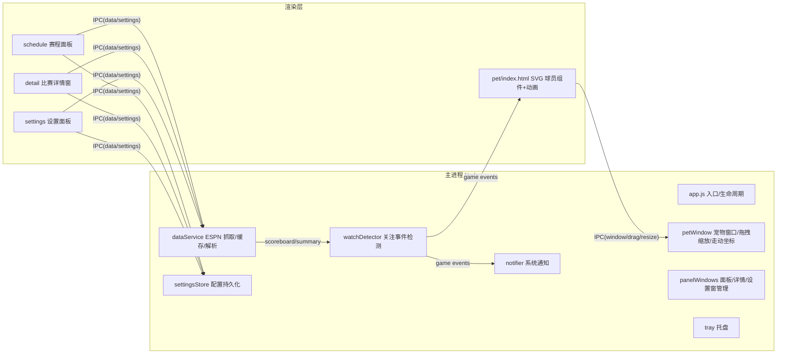

# 技术方案：BoardPet　日期 2026-10-10

## 结论
Electron + 原生 JS（无前端框架依赖的轻量渲染层）：主进程负责窗口管理、ESPN 数据服务、关注事件检测与系统通知；渲染层用参数化 SVG 组件绘制 Q 版球员（配色/号码/名字/动作全部可编程），Web Animations 实现运球/走动/庆祝。数据走 ESPN 免费公开接口（NBA 官方接口本机网络不可用，已实测）。分支策略：单人主干开发（main 直接提交）。

## 1. 技术选型
| 维度 | Electron（选定） | Tauri | WPF |
|---|---|---|---|
| 数据面板/动画开发效率 | 高（HTML/CSS/SVG） | 高（同 Web 技术） | 低（XAML 手写） |
| 包体积/内存 | 大（~100MB / ~150MB） | 小 | 中 |
| 生态与调试 | 最成熟 | 成熟但 Rust 侧门槛 | Windows 专属 |
| 结论 | 用户第 1 轮已拍板；开发效率优先 | 备选 | 否 |

补充决策（默认假设范围内）：数据源选 **ESPN 公开接口**；形象采用**参数化 SVG** 而非 AI 位图（见调研报告风险表）。

## 2. 架构与模块划分


| 模块 | 职责 |
|---|---|
| main/app.js | 入口：单实例锁、窗口装配、自启动 |
| main/petWindow.js | 宠物窗口创建、自定义拖拽（IPC move）、滚轮缩放、走动坐标推进、位置持久化 |
| main/dataService.js | ESPN 请求封装（超时/重试/UA）、内存缓存 + 定时刷新、字段解析（集中在此，可单测） |
| main/watchDetector.js | 状态快照对比：开赛/ halftime→Q3/反超追平/得分高潮(≥8)/胜负已分，产出事件 |
| main/notifier.js | Windows 通知，点击打开详情窗 |
| main/panelWindows.js | 赛程面板/详情窗/设置窗的创建与定位（宠物旁弹出） |
| renderer/pet | SVG 球员组件（参数：肤色/发型/胡须/球衣主副色/号码/名字）+ 动画状态机（idle/dribble/walk/celebrate/sad） |
| renderer/schedule · detail · settings | 三个 HTML 页面，经 preload 暴露的 API 与主进程通信 |

## 3. 数据模型
settings.json（userData，版本化）：
```json
{ "version": 1,
  "pet": { "player": "lebron", "custom": {"name":"","number":"","teamId":""},
           "jersey": {"primary":"#ED174C","secondary":"#006BB6"},
           "sizePct": 100, "x": null, "y": null },
  "watch": { "teamIds": ["PHI"], "starredEvents": [], "mutedEvents": [] },
  "behavior": { "walk": true, "alwaysOnTop": true, "notify": true, "celebrate": true },
  "app": { "autoLaunch": false } }
```
运行时状态（内存）：`scoreboardCache[date]`、`gameStates[eventId] = {statusId, period, homeScore, awayScore, lastDiff}`。

## 4. 接口设计
### 4.1 ESPN 只读接口（GET，均带 UA，超时 10s）
| 接口 | 路径 | 用途 |
|---|---|---|
| 赛程 | `/apis/site/v2/sports/basketball/nba/scoreboard?dates=YYYYMMDD` | 当日比赛、比分、状态、队徽 |
| 详情 | `/apis/site/v2/sports/basketball/nba/summary?event={id}` | boxscore 球员数据、比赛头信息 |
| 球队 | `/apis/site/v2/sports/basketball/nba/teams` | 30 队 id/缩写/名称/配色（设置用） |

解析要点（集中 dataService）：状态映射 `STATUS_SCHEDULED/IN_PROGRESS/HALFTIME/END_OF_PERIOD/FINAL`；boxscore 从 `boxscore.players[].statistics[].headers/totals/athletes[].stats` 按表头名索引取 `MIN/PTS/REB/AST/FG/+/-`，缺失容错为 `—`。
### 4.2 IPC（preload 暴露 `window.boardpet`）
| 通道 | 方向 | 入参 | 出参 |
|---|---|---|---|
| `data:getScoreboard` | R→M | date? | {events[], watchFlags} |
| `data:getSummary` | R→M | eventId | {header, awayBox[], homeBox[]} |
| `data:getTeams` | R→M | — | {teams[]} |
| `pet:move / pet:resize` | R→M | dx,dy / pct | — |
| `pet:openPanel / openGame / openSettings` | R→M | eventId? | — |
| `settings:get / settings:set` | R→M | patch | settings |
| `events:celebrate` | M→R | {type} | 宠物动画触发 |
| `events:gameUpdate` | M→R | {events} | 面板实时刷新 |

## 5. 目录结构
```
BoardPet/
├─ src/main/        app.js petWindow.js dataService.js watchDetector.js
│                   notifier.js panelWindows.js settingsStore.js tray.js ipc.js poller.js
├─ src/preload/     pet.js panels.js
├─ src/renderer/    pet/ schedule/ detail/ settings/ common.css  (各 index.html+css+js)
├─ src/shared/      espn.js(常量/状态映射) presets.js(球星/球队) character.js(参数化 SVG 球员)
├─ tests/           espn.test.js + fixtures/（node:test）
├─ scripts/         gen-icon.js（生成 icon.ico/tray.png/icon.png）
├─ assets/          icon.ico icon.png tray.png
└─ docs/
```

## 6. 里程碑计划
| 里程碑 | 内容 | 完成标志 |
|---|---|---|
| M1 宠物核心 | 宠物窗口/拖拽/缩放/待机动画/右键菜单/走动/托盘/设置持久化 | 宠物可交互常驻，`npm start` 实跑 |
| M2 数据层 | dataService + 解析单测 + 关注检测 | 无界面下可取数、解析测试通过 |
| M3 面板 | 赛程面板 + 比赛详情窗 + 自动刷新 + 设置面板(形象/关注/大小) | 全链路手动可查赛看比分 |
| M4 联动与交付 | 提醒/庆祝动画、走动增强、打包绿色版（实施时采用 @electron/packager，见发布记录） | PRD 全部 P0 验收标准通过 |

## 7. 风险与应对
| 风险 | 应对 |
|---|---|
| ESPN 字段结构变化 | 解析集中在 dataService + 单测锁定；异常显示「数据暂不可用」 |
| 通知点击无法直达（Windows 通知点击回调受限） | 通知点击回调用 Electron Notification click 事件打开详情窗（已验证 API 支持） |
| 拖拽与点击冲突 | 不用 app-region，自定义 mousedown/mousemove IPC 拖拽，位移阈值 3px 区分点击 |
| 走动被全屏应用遮挡干扰 | 走动范围限工作区底边，置顶可关 |
